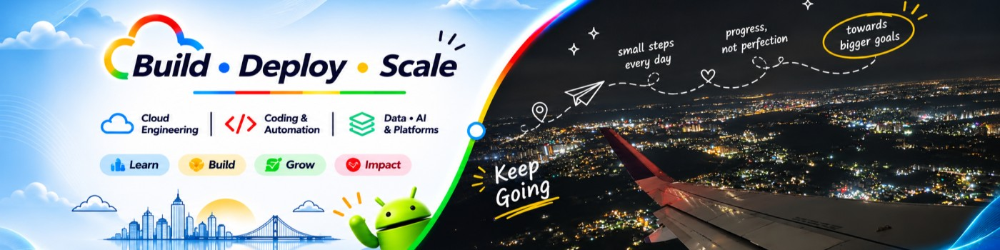
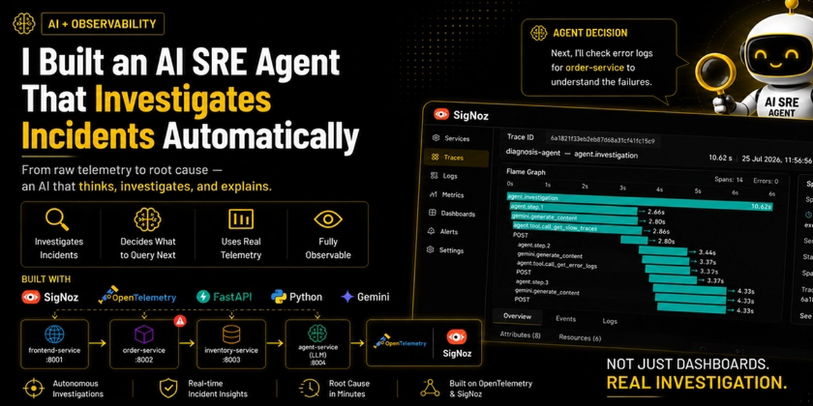
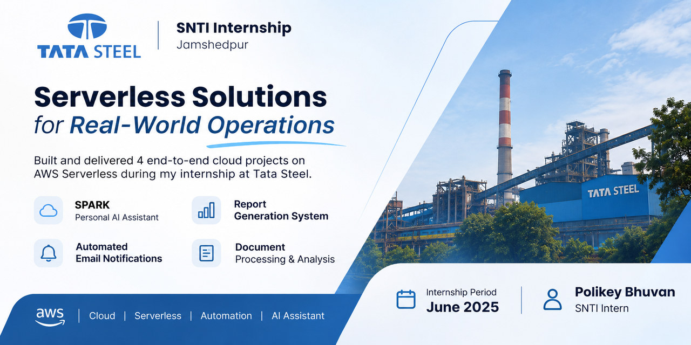
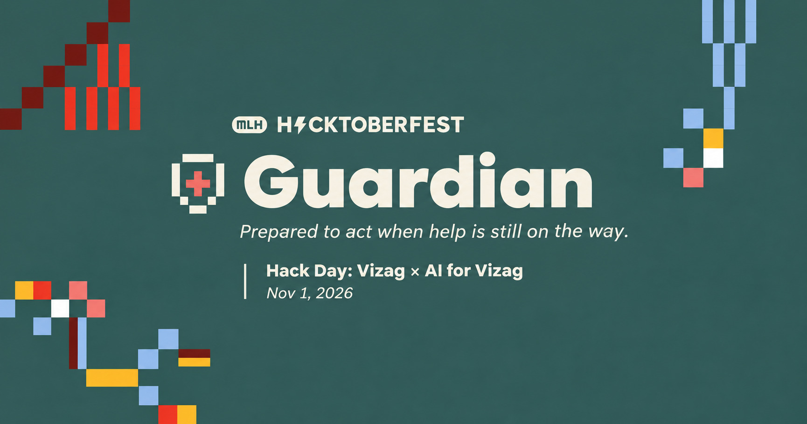

# Polikey Bhuvan

### B.Tech Computer Science Student · Cloud Engineering · AI

**Centurion University of Technology and Management · Class of 2027**  
**Former Tata Steel SNTI Intern**

*Building in the cloud, learning with purpose, and exploring how AI can solve real problems.*

---

## About me

I’m a fourth-year **B.Tech Computer Science** student specializing in **Cloud Engineering**. I’m focused on building cloud projects for hackathons and growing the skills to design and operate reliable cloud systems.

I worked with **AWS** during my Tata Steel SNTI internship and am currently developing my **Google Cloud** skills through hands-on labs and learning paths. I’m also exploring **generative AI, AI agents, and on-device AI**.

## Cloud + AI journey

| 🎓 Student | ☁️ Cloud | 🤖 AI |
|:--:|:--:|:--:|
| B.Tech Computer Science  ·  Class of 2027 | AWS internship projects  ·  Google Cloud learning | Generative AI  ·  AI agents  ·  On-device AI |

## Selected projects

<table>
  <tr>
    <td width="33%" valign="top" align="center">
      
      <h3><a href="https://github.com/polikeybhuvan/signoz-ai-sre-agent">AI SRE Agent</a></h3>
      
Investigates incidents with Gemini across SigNoz logs and traces. Top 100 of 350+ hackathon entries at Agents of SigNoz.

      
Python · Gemini · FastAPI SigNoz · OpenTelemetry

    </td>
    <td width="33%" valign="top" align="center">
      
      <h3><a href="https://github.com/polikeybhuvan/tata-steel-serverless-internship">Tata Steel · AWS Serverless</a></h3>
      
Four SNTI internship projects across AWS hosting, event-driven workflows, text-to-audio, notifications, and a conversational assistant.

      
AWS · Lambda · S3 · SNS Polly · Lex V2

    </td>
    <td width="33%" valign="top" align="center">
      
      <h3><a href="https://github.com/polikeybhuvan/Guardian">Guardian</a></h3>
      
Offline-first Android emergency app with India maps, SOS tools, and on-device Gemma guidance for limited-connectivity situations.

      
Android · Kotlin · Gemma 3 Offline maps · On-device AI

    </td>
  </tr>
</table>

## Skills & tools

**Cloud platforms**  

**AI, observability & development**  

### Google Cloud learning

Earned **120+ Google Cloud Skills badges** across Cloud and AI topics, including architecture, networking, security, Kubernetes, serverless, generative AI, Vertex AI, and MLOps.

[Explore my Google Cloud Skills profile →](https://www.skills.google/public_profiles/b3452349-3c62-49a7-9a53-6695f04d8ad5)

---

### Building cloud projects for hackathons · Growing as a Cloud Engineer

[LinkedIn](https://www.linkedin.com/in/polikeybhuvan/) · [Email](mailto:polikeybhuvan@gmail.com)

